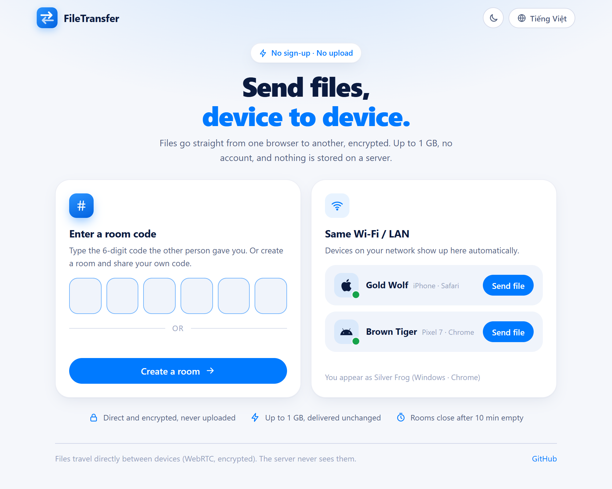

<div align="center">


# FileTransfer

**Send files directly between devices, right in the browser.**<br>
Peer-to-peer over WebRTC. No uploads, no account, no install.

### [🚀 Live demo → file.vit.io.vn](https://file.vit.io.vn)

[](https://github.com/vitvu/FileTransfer/actions/workflows/ci.yml)
[](LICENSE)
[](docs/DEPLOYMENT.md)
[](https://paypal.me/vudinhviet)



</div>

## Features

- **Direct and encrypted.** File data goes from one browser straight to the other (WebRTC, DTLS). It never touches a server.
- **Two ways to connect.** Devices on the same network find each other automatically, or pair across networks with a 6-digit room code or a shareable link.
- **Know who's who.** Nearby devices show an OS icon and label, with versions, such as *iPhone (iOS 17.5) · Safari 17*, *Windows 11 · Chrome 130* or *Pixel 7 (Android 14) · Chrome 130*. Tabs of the same browser never show up as other devices. For a code room, the IP address and network provider of the other device are shown too, so you can tell the devices apart. The transfer popup also tells you whether the link is direct or goes through a relay.
- **A clear popup for every transfer.** As soon as someone presses **Send**, the other device shows "*X is choosing a file…*". When the file is picked, the same popup shows who is sending, an image preview (or a file-type icon) and the size, with **Accept** / **Decline**. Progress and the result stay in that popup, and the rest of the page steps out of the way.
- **Big files.** Up to 1 GB, delivered unchanged. Small files just download; on Chrome and Edge, files over 200 MB are streamed to disk so memory stays flat.
- **Clean and light.** Zero runtime dependencies. English and Vietnamese (picked from your browser), light theme by default with a dark-mode button.

## Using it

| To connect… | Do this |
|-------------|---------|
| **On the same Wi-Fi / LAN** | Open the page on both devices. Each shows up in the other's *Same Wi-Fi / LAN* card. Press **Send file** (or drop a file on the device) and the other side presses **Accept**. |
| **From anywhere** | Press **Create a room**, then share the 6-digit code or the link. The other person types the code into the six boxes (pasting works) or opens the link. |

## How it works

```
   Device A                                        Device B
      │  1. WebSocket to the signaling Worker          │
      ├────────────►  (handshake only)  ◄──────────────┤
      │  2. swap WebRTC offer / answer / ICE           │
      │  3. STUN lookup of public addresses            │
      ╞═══════ 4. direct, encrypted data channel ══════╡
                  the file travels only here
```

The web app (`public/`) is static. A single Cloudflare Worker with a Durable Object (`src/worker.js`) groups devices into a LAN group or a room and relays a few KB of handshake messages. After step 3 it is no longer involved. Both are deployed together on one hostname.

## Privacy

- **File contents never reach the Worker or any server.**
- **The Worker sees** your IP (to group devices on one network), a random id and name, your coarse device info, and the handshake messages it relays. Nothing is stored or logged; the only persisted state is a "room is active" flag that expires 10 minutes after the room empties.
- **The receiver sees** a small preview (a JPEG thumbnail of about 15-35 KB) of an image *before* accepting it, plus your device label. They also see that you are choosing a file.
- **Other parties see** your IP: WebRTC shows it to the device you connect to and to the STUN servers (Cloudflare and Google). The device you connect to also sees your OS, browser and their versions, for example *iPhone (iOS 17.5) · Safari 17*. In a code room, the other device also sees your public IP address, network provider and country (that is the point of the code: you are choosing to connect to them).
- **No tracking.** No analytics, cookies or third-party scripts (enforced by a strict Content Security Policy). The only thing kept in `localStorage` is your light/dark choice.
- **Hardened.** Origin allow-list, validated inputs, best-effort rate limits, 2-device rooms, and security headers (CSP, HSTS and more).
- **Room codes are not secrets.** The receiver must approve every file and rooms expire quickly, but do not rely on a code to protect sensitive data.

Found a vulnerability? See [SECURITY.md](SECURITY.md).

## Run locally

Requires [Node.js](https://nodejs.org/) 20+.

```bash
git clone https://github.com/vitvu/FileTransfer.git
cd FileTransfer
npm install
npm run dev        # http://localhost:8787 (open it in two windows)
npm test           # signaling tests, while the dev server is running
```

## Deploy your own

Free on Cloudflare, no credit card: `npx wrangler login && npm run deploy`. Set your hostname and allowed origin in `wrangler.toml` first. Full guide, configuration options and hosting the UI elsewhere: **[docs/DEPLOYMENT.md](docs/DEPLOYMENT.md)**.

## Browser support and limits

| | Send | Receive |
|---|:---:|---|
| Chrome, Edge (desktop) | ✅ | ✅ downloads directly; files over 200 MB ask where to save and stream to disk |
| Firefox, Safari, mobile | ✅ | ✅ buffered in memory, then downloaded |

- **Relay is optional and limited.** Strict networks (symmetric NAT, some corporate Wi-Fi or mobile carriers) cannot connect directly. A TURN relay ([deployment guide](docs/DEPLOYMENT.md)) lets those transfers work; relayed data stays end-to-end encrypted. Because relay bandwidth is a shared free resource, the app is deliberately strict with it:
  - Direct connections (same Wi-Fi, IPv6, ordinary NAT) are never limited: up to **1 GB** per file.
  - Through the relay (code rooms only): **25 MB per file**, **one file every 30 seconds** per device and per IP address, and a daily cap on relay sessions for everyone (150 by default, `RELAY_DAILY_MAX`).
  - Sizing: about 10 people a day sending about 10 files of 25 MB is roughly 2.5 GB a day, around 75 GB a month. That fits Cloudflare Realtime TURN (1 TB/month free); a 500 MB plan such as Metered's no-card tier only lasts for a few dozen transfers.
- **One file at a time** per pair of devices, **1 GB** per file.
- **"Nearby" means "same public IP".** Behind a VPN or proxy, use a room code instead.
- **Speed depends on the browsers and network.** Expect tens of MB/s on a good local network, not line rate.
- **iPhone model names (like "iPhone 11") are not available to websites.** iOS only reveals "iPhone" or "iPad"; Android shows the model where the browser allows it.

## Support

FileTransfer is free, open source and ad-free. If it saved you time, you can chip in for hosting and development:

[](https://paypal.me/vudinhviet)

Starring the repo or sharing the app helps just as much.

## Contributing

Issues and pull requests are welcome. See [CONTRIBUTING.md](CONTRIBUTING.md) and the [CHANGELOG](CHANGELOG.md).

## License

[MIT](LICENSE) © vitvu
