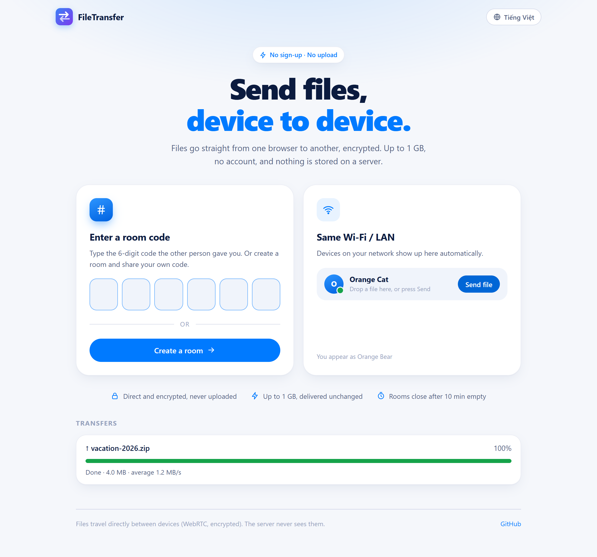
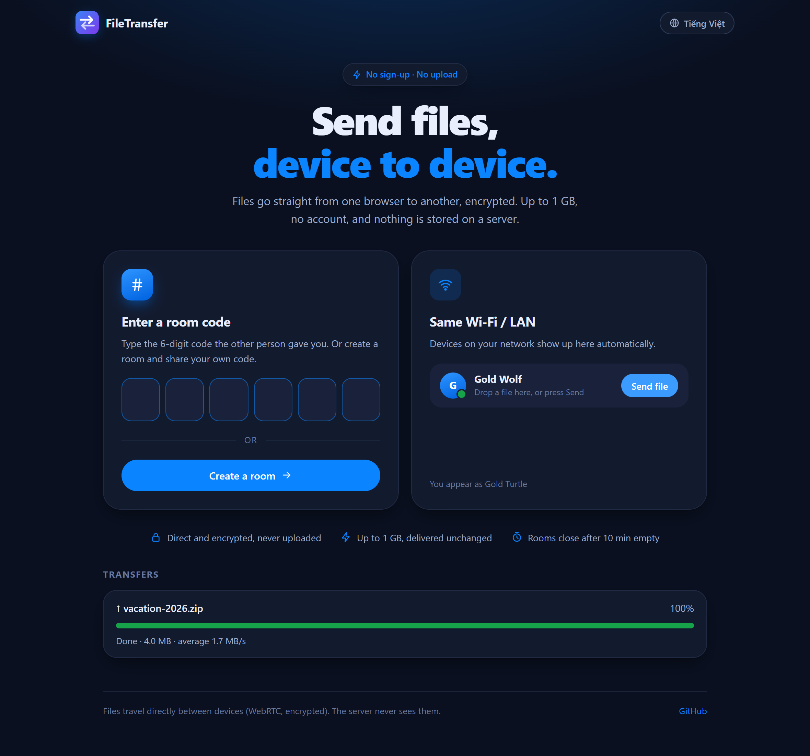
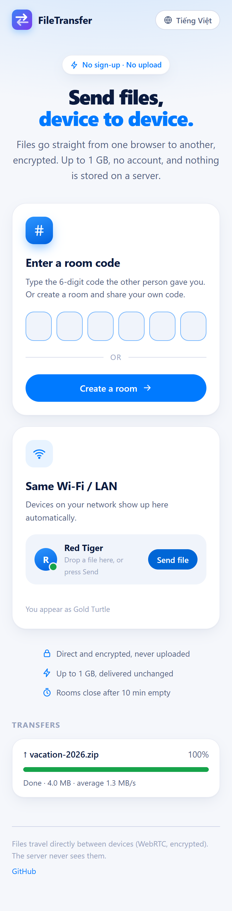

<div align="center">


# FileTransfer

**Send files directly between devices, right in the browser.**<br>
Peer-to-peer over WebRTC. No uploads, no account, no install.

[**Open the app → file.vit.io.vn**](https://file.vit.io.vn)

[](https://github.com/vitvu/FileTransfer/actions/workflows/ci.yml)
[](LICENSE)


<br>



<br>


&nbsp;


</div>

## Why

Most "share a file" tools upload your data to somebody's server first. FileTransfer doesn't: the two browsers connect to each other and the file travels **straight from one device to the other**, encrypted end to end. A tiny signaling server introduces the two devices and then steps out of the way.

- **Nearby devices.** Open the page on two devices on the same network and they find each other, like AirDrop or Snapdrop.
- **Room codes.** No shared network? Create a room, read out the 6-digit code, and connect from anywhere.
- **Big files.** Up to 1 GB, delivered byte-for-byte unchanged. On Chrome and Edge the receiver streams to disk, so memory stays flat.
- **You stay in control.** The receiver approves every file. Either side can cancel at any time.
- **Nothing to install, nothing to sign up for.** Plain HTML/CSS/JS with zero runtime dependencies.
- **Your language, your theme.** English and Vietnamese UI picked from the browser language (switchable in the header), light and dark theme that follow the system.

## Using it

The home page has two cards:

| Card | Use it when | Steps |
|------|-------------|-------|
| **Enter a room code** (left) | The devices are on different networks, or you want an explicit pairing. | Press **Create a room** and read out the 6-digit code (or use **Copy link**), then the other person types the code into the six boxes (pasting works too) or opens the link. |
| **Same Wi-Fi / LAN** (right) | Both devices are on the same network. | Open the page on both. Each device shows up in the other's card. Press **Send file** (or drop a file on the device), and the receiver presses **Accept**. |

## Table of contents

[How it works](#how-it-works) · [Run locally](#run-locally) · [Deploy your own](#deploy-your-own) · [Configuration](#configuration) · [Privacy and security](#privacy-and-security) · [Browser support](#browser-support) · [Limitations](#limitations) · [Project structure](#project-structure) · [Contributing](#contributing)

## How it works

```
      Device A                                         Device B
         │  1. open a WebSocket (handshake only)          │
         ├──────────────►  Signaling Worker  ◄────────────┤
         │            (same network / same room)          │
         │  2. swap WebRTC offer, answer and ICE info     │
         │  3. ask a STUN server for the public address   │
         │                                                │
         ╞═════ 4. direct, encrypted data channel ════════╡
                    the file travels only here
```

1. Both devices open a WebSocket to the signaling Worker. It places them in the same Durable Object: a **LAN group** (devices sharing a public IP) or a **room** (devices that entered the same code).
2. The Worker relays a few KB of handshake messages (SDP and ICE candidates) between them.
3. The browsers use public STUN servers to find a route to each other and open an `RTCDataChannel` (DTLS-encrypted).
4. The sender streams the file in 64 KB messages with backpressure and read-ahead. The receiver writes it to disk with the File System Access API or, where that is unavailable, buffers it and triggers a download.

After step 3 the Worker is no longer involved in the transfer.

| Part | Runs on | Role |
|------|---------|------|
| [`public/`](public) | Cloudflare static assets | The web app. Served from the edge and never invokes Worker code. |
| [`src/worker.js`](src/worker.js) | Cloudflare Worker + Durable Object | WebSocket signaling and room bookkeeping. Only `/ws` reaches it. |

Both are deployed together as a single Worker on one hostname, so there is no CORS to configure.

## Run locally

Requirements: [Node.js](https://nodejs.org/) 20 or newer.

```bash
git clone https://github.com/vitvu/FileTransfer.git
cd FileTransfer
npm install
npm run dev
```

Open <http://localhost:8787> in two browser windows: they appear as each other's nearby device. `npm run dev` serves the UI and signaling from one origin, so nothing needs configuring.

Other devices need a secure context (HTTPS or `localhost`) for WebRTC and the File System Access API, so test those against a deployed copy rather than a plain `http://192.168.x.x` address.

```bash
npm test      # signaling integration tests (run while `npm run dev` is up)
```

## Deploy your own

You need a free [Cloudflare account](https://dash.cloudflare.com/sign-up). No credit card is required.

### Option A: your own domain (recommended)

The domain's DNS must be managed by Cloudflare. Edit [`wrangler.toml`](wrangler.toml):

```toml
routes = [{ pattern = "files.example.com", custom_domain = true }]
workers_dev = false

[vars]
ALLOWED_ORIGINS = "https://files.example.com"
```

```bash
npx wrangler login
npm run deploy
```

Wrangler creates the DNS record and TLS certificate for you.

> If the command ends with `This Worker does not exist on your account` right after a successful upload, Cloudflare's API simply has not caught up yet. Wait about 20 seconds and run `npx wrangler triggers deploy` to finish attaching the domain.

### Option B: a free `workers.dev` address

Remove the `routes` line, set `workers_dev = true`, and set `ALLOWED_ORIGINS` to the URL that Wrangler prints (for example `https://filetransfer.<your-subdomain>.workers.dev`). Deploy again.

> The `workers.dev` hostname contains your Cloudflare account subdomain. If you publish the URL anywhere public and would rather not reveal it, use Option A or rename the subdomain in the dashboard.

### Automatic deploys from GitHub (optional)

[`.github/workflows/deploy.yml`](.github/workflows/deploy.yml) deploys on every push to `main`. It stays idle until you add two repository secrets (**Settings → Secrets and variables → Actions**):

| Secret | Value |
|--------|-------|
| `CLOUDFLARE_API_TOKEN` | An API token created from the *Edit Cloudflare Workers* template. |
| `CLOUDFLARE_ACCOUNT_ID` | Your account id (shown in the dashboard sidebar). |

### Hosting the UI elsewhere

The static files in `public/` work on any host (Cloudflare Pages, GitHub Pages, Netlify, cPanel). Deploy the Worker as above, add the site's origin to `ALLOWED_ORIGINS`, and set `signalingUrl` in [`public/config.js`](public/config.js) to `wss://<worker-host>/ws`. cPanel cannot run the signaling server itself because it does not support WebSocket servers.

## Configuration

| Setting | Where | Purpose |
|---------|-------|---------|
| `ALLOWED_ORIGINS` | `wrangler.toml` | Origins allowed to open a signaling connection. The page's own origin is always allowed. |
| `signalingUrl` | `public/config.js` | Signaling WebSocket URL. Empty means "same origin". |
| `MAX_SIZE`, `CHUNK`, `HIGH`, `LOW` | `public/app.js` | File size limit and flow-control tuning. |
| `ICE` | `public/app.js` | STUN and TURN servers. |
| Translations | `public/i18n.js` | English and Vietnamese strings. Add a language by adding a dictionary. |
| `ROOM_IDLE_MS`, `ROOM_MAX`, `LAN_MAX` | `src/worker.js` | Room expiry (10 min), room size (2), LAN group size (20). |

## Privacy and security

- **File contents never reach the Worker or any server.** They travel over a DTLS-encrypted WebRTC channel directly between the two browsers.
- **What the Worker sees:** your IP address (to group devices on one network), a random per-connection id and display name, and the handshake messages it relays. None of this is stored or logged. The only persisted state is a boolean "room is active" flag, deleted 10 minutes after a room empties. Worker observability is disabled in `wrangler.toml`.
- **What others see:** WebRTC inherently shows your IP address to the device you connect to and to the STUN servers used for discovery (Cloudflare and Google by default).
- **No tracking.** No analytics, cookies, `localStorage` or third-party scripts. A strict Content Security Policy (`script-src 'self'`) enforces this in the browser.
- **Hardened inputs.** Origin allow-list, 16 KB signaling message limit, 2-device rooms, and all peer-supplied text rendered with `textContent`.
- **Room codes are not secrets.** A 6-digit code is a convenience, not authentication. The receiver must approve every file and rooms expire quickly, but do not rely on the code to protect sensitive data. Add a Cloudflare WAF rate-limiting rule for `/ws` to make guessing impractical.

Found a vulnerability? Please follow [SECURITY.md](SECURITY.md).

## Browser support

| Browser | Send | Receive |
|---------|:----:|---------|
| Chrome, Edge (desktop) | ✅ | ✅ streamed straight to disk |
| Firefox, Safari | ✅ | ✅ buffered in memory, then downloaded |
| Mobile browsers | ✅ | ✅ buffered in memory, then downloaded |

## Limitations

- **No TURN relay.** Some networks (symmetric NAT, strict corporate or campus Wi-Fi, some mobile carriers) block direct peer-to-peer connections, and the transfer cannot start there. Devices on the same LAN almost always connect. Adding a TURN server such as [coturn](https://github.com/coturn/coturn) to `ICE` in `public/app.js` fixes this at the cost of relaying traffic through that server.
- **One file at a time** between a pair of devices.
- **1 GB per file.** Without disk streaming, the receiving browser holds the file in memory.
- **"Nearby" means "same public IP".** Devices behind a VPN or proxy may not see each other; use a room code instead.
- **Speed depends on the browsers and the network.** WebRTC data channels are typically slower than raw TCP, so expect tens of MB/s on a good local network, not line rate.

## Project structure

```
.
├── public/                 Static web app
│   ├── index.html
│   ├── app.js              WebRTC, file transfer and UI logic
│   ├── i18n.js             English / Vietnamese strings (auto-detected, switchable)
│   ├── config.js           Runtime configuration
│   └── style.css
├── src/worker.js           Signaling Worker and Room Durable Object
├── test/                   Signaling integration tests
├── docs/screenshots/       Images used in this README
├── wrangler.toml           Production deployment
├── wrangler.dev.toml       Local development (UI + Worker on one origin)
└── .github/                CI, deploy workflow, issue and PR templates
```

## Contributing

Issues and pull requests are welcome. Read [CONTRIBUTING.md](CONTRIBUTING.md) first, and see the [CHANGELOG](CHANGELOG.md) for release notes.

## License

[MIT](LICENSE) © vitvu
